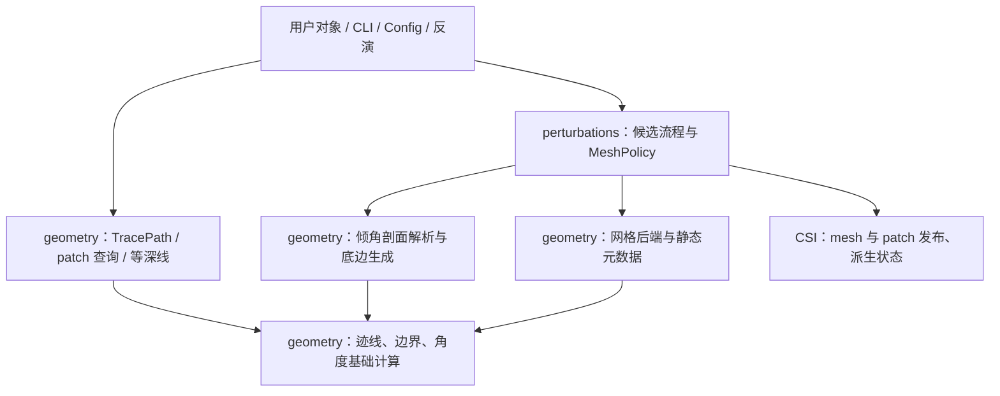

# 几何支撑源码与依赖

本文供阅读和扩展源码时使用。完成科研任务请先看
[迹线预处理](../workflows/02d_fault_trace_preprocessing.md)、
[断层几何构建](../reference/fault_geometry_construction.md)或
[几何扰动](../reference/geometry_perturbation.md)。包的整体关系见
[源码与文档架构](architecture.md)。

## 源码位置

`eqtools/csiExtend/geometry/` 是断层几何支撑的实现拥有者。它保持一层目录，按输入、
输出和科学职责区分模块；同一目录中的计算不因此共享一个公式或一种状态生命周期。

| 模块 | 职责与阅读顺序 |
| --- | --- |
| `trace_ops.py` | 投影平面中的迹线数值操作；先读距离、清理和点投影合同 |
| `trace_markers.py` | 距离、比例、经纬度截线、最近点到统一位置标记的解析 |
| `trace_processing.py` | `TracePath`、投影适配、不可变处理流程和操作历史 |
| `trace_io.py` | 多段迹线、文本/GeoJSON 读写与显式覆盖策略 |
| `geom_ops.py` | 顶底边界验证、平面弧长、保留节点的加密、边界交点 |
| `patch_indices.py` | fault 对象的 patch 查询、编号校验和迹线范围选择 |
| `fault_angle_conventions.py` | 有方向参考倾角与 compact solver 几何的不同转换合同 |
| `angle_utils.py` | 角度单位、圆周平均和参数长度展开；不拥有扰动流程 |
| `DipInterpolation.py` | 沿深度倾角剖面、分层插值及深度投影倾角校验 |
| `dip_profile.py` | 非分层沿走向剖面声明、位置解析和 sampled/fixed 参数映射 |
| `dip_transition_analysis.py` | 冻结参考顶边的只读曲率与转换带预分析 |
| `dip_geometry.py` | 已解析倾角到走向与底边坐标的几何生成原语 |
| `fault_contours.py` | 断层面与等深平面的几何交线、线段拼接与诊断 |
| `MeshGenerator.py` | 结构化表面及 Gmsh 映射后端 |
| `make_mesh_dutta.py` | Dutta 式倾角曲线、底边修正和网格生成后端 |
| `parametric_mesh.py` | 三维弦长参数域网格与变形后端；不隐式替换现有方法 |
| `mesh_registry.py` | mesh 方法参数、重放和禁止项的单一静态元数据表 |

源码目录中的 `geometry/README.md` 提供逐文件短索引；本页维护完整的依赖、科学差异和
迁移约定。各模块开头解释职责，具体函数文档解释参数形状、单位、坐标和返回布局。

## 按任务选择模块

| 任务 | 从哪里开始 | 继续阅读 |
| --- | --- | --- |
| 读取、定位、裁剪或连续处理迹线 | `TracePath` / trace CLI | `trace_processing` -> `trace_markers` -> `trace_ops`；格式与覆盖策略查 `trace_io` |
| 计算顶底边界或验证局部网格单元 | fault 对象的对应方法 | `geom_ops`；先确认节点对应关系和使用的距离定义 |
| 查询 patch 子集 | 包级 patch 查询函数或 fault 方法 | `patch_indices`；约束的生成仍属于约束管理器 |
| 声明沿走向倾角与定位 controls | fault 的 profile 声明方法 | `dip_profile` -> `dip_geometry`；预分析查 `dip_transition_analysis` |
| 构建随深度变化的分层倾角 | 分层 fault 对象 | `DipInterpolation`；不套用非分层 controls 的 resolver |
| 选择或扩展网格后端 | fault 的 mesh 方法 / `MeshPolicy` | `mesh_registry` 和实际后端；参数化、结构化与 Dutta 后端分别阅读 |
| 提取几何等深线 | `FaultGeometryEngine.extract_contours_from_fault` | `geometry.fault_contours` |
| 提取 slip/coupling 等标量等值线 | `Contour3DExtraction` | `statUtils.contour3D_extraction`；不是几何等深线兼容入口 |

## 用户调用与实现导入

用户继续使用现有公开入口和断层对象方法。例如：

```python
from eqtools.csiExtend import TracePath, process_trace

path = TracePath.from_lonlat([[100.0, 30.0], [100.1, 30.1]])
result = process_trace(path, [{"op": "reverse"}])
```

包内实现直接导入实际拥有者；阅读具体算法时也可使用规范模块路径：

```python
from eqtools.csiExtend.geometry.trace_ops import cumulative_distance
from eqtools.csiExtend.geometry.trace_markers import resolve_trace_marker

xy = [[0.0, 0.0], [3.0, 4.0]]  # 投影坐标，单位 km
distance_km = cumulative_distance(xy)
marker = resolve_trace_marker(xy, {"trace_distance_km": 2.5}, coord_system="xy")
```

`csiExtend` 公开的单数 `resolve_trace_marker(fault, ...)` 仍由
`geometry.patch_indices` 提供，接受 fault 对象。`geometry.trace_markers` 中的同名函数
接受迹线数组及坐标转换器。两者签名和使用边界不同，不在包入口中互相覆盖。

## 依赖方向与状态拥有者

箭头表示调用者导入或调用被调用者：



- `geometry/__init__.py` 不批量导入 NumPy、CSI、Matplotlib、Gmsh 或反演类。
  显式导入具体后端时，仍会加载该后端原有的运行依赖。
- `TraceProjection` 在创建投影适配器时复用 CSI `SourceInv`；`TracePath` 也接受既有
  `ll2xy/xy2ll` 提供者。迹线数值核不创建 fault，也不修改其几何。
- 剖面解析、底边生成和等深线提取不反向依赖 `perturbations`、Config、统计包或绘图包。
- mesh 后端可以拥有准备好的映射状态。fault 对象、扰动流程与 CSI 继续负责参考冻结、
  候选物化、权威 mesh 发布及 GF/Laplacian/面积/邻接等派生状态的有效性。
- `patch_indices` 决定选择哪些 patch；约束管理器决定怎样对这些 patch 施加约束。
  编号查询不生成零滑或 Euler 约束。

`Adaptive*Patches`、`BayesianAdaptiveTriangularPatches`、`FaultGeometryEngine` 和反演类
继续作为主要对象入口。SAR 投影属于 `sarUtils`，滑动转换专用几何属于
`slip_conversion`，领域绘图属于 `eqtools.viztools`；通用图形配置属于 `ecat_viz`。

## 必须保留的计算差异

| 接口或领域 | 科学合同 | 不能替换成什么 |
| --- | --- | --- |
| `trace_ops.cumulative_distance` | x/y 平面距离；先清除连续重复平面点 | 三维弦长或保留原始节点编号的边界运算 |
| `geom_ops.polyline_arclength` | x/y 平面距离；保留对齐列并拒绝零长度平面段 | 自动清除节点的 trace 运算 |
| `parametric_mesh._cumulative_arc_length` | 三维节点间弦长，含垂直段 | 仅 x/y 的迹线距离 |
| 有方向参考倾角 | 在有序参考顶边上保留倾向；负倾角可转成连续 `(0, 180)` 表示 | compact solver 的倾角和走向归一化 |
| compact solver 角度 | 必要时翻转走向，将几何倾角映射至 `[0, 90]` | 沿走向 profile 的插值表示；也不在此转换 slip/rake |
| 非分层与分层倾角 | 分别表达沿走向 controls 和沿深度/分层剖面 | 因名字相似而共用同一个 resolver |
| 几何等深线与标量等值线 | 前者是 mesh 与深度平面的交线；后者是 slip/coupling 等字段等值线 | 相互替换的投影、插值或阈值算法 |

例如节点 `[(0,0,0), (3,4,12), (3,4,14), (6,8,14)]`：trace 距离是清理后的
`[0,5,10]`；三维弦长是 `[0,13,15,20]`；边界平面弧长会拒绝其中零长度平面段。
三个结果体现不同输入合同，不是待统一的计算误差。

`geom_ops` 和 `MeshGenerator` 中同名的平均方向实现也保留各自位置。统一目录不能成为
合并算法的理由；需要合并时，必须先核对方向符号、节点保留、容差、端点、返回布局和
实际消费者，并提供独立的数值等价证据。

<a id="geometry-import-migration"></a>
## 旧模块路径迁移

14 个根层几何模块和两个 `perturbations` 工具模块的旧文件已移除。使用这些旧路径会收到
`ModuleNotFoundError`；根据下表更换模块路径，导入的函数或类名保持不变。不要在新脚本中
自行创建同名壳层或改动 `sys.modules` 来绕过迁移。

表中路径均以 `eqtools.csiExtend.` 为前缀。例如旧 `geom_ops` 对应
`eqtools.csiExtend.geom_ops`，新 `geometry.geom_ops` 对应
`eqtools.csiExtend.geometry.geom_ops`。

| 已移除的旧模块 | 当前实现模块 |
| --- | --- |
| `trace_ops` | `geometry.trace_ops` |
| `trace_markers` | `geometry.trace_markers` |
| `trace_processing` | `geometry.trace_processing` |
| `trace_io` | `geometry.trace_io` |
| `geom_ops` | `geometry.geom_ops` |
| `patch_indices` | `geometry.patch_indices` |
| `fault_angle_conventions` | `geometry.fault_angle_conventions` |
| `DipInterpolation` | `geometry.DipInterpolation` |
| `dip_profile` | `geometry.dip_profile` |
| `dip_transition_analysis` | `geometry.dip_transition_analysis` |
| `MeshGenerator` | `geometry.MeshGenerator` |
| `make_mesh_dutta` | `geometry.make_mesh_dutta` |
| `parametric_mesh` | `geometry.parametric_mesh` |
| `mesh_registry` | `geometry.mesh_registry` |
| `perturbations.angle_utils` | `geometry.angle_utils` |
| `perturbations.dip_ops` | `geometry.dip_geometry` |

```python
from eqtools.csiExtend.geometry.trace_processing import TracePath
from eqtools.csiExtend.geometry.geom_ops import polyline_arclength
from eqtools.csiExtend.geometry.dip_profile import DipControlPoints
```

### 保留的入口

- `eqtools.csiExtend` 已有公开类/函数入口继续直接绑定实现，例如 `TracePath`、`process_trace`
  和 patch 查询函数；这次清理不移除这些 API，也不改变其签名。
- `FaultGeometryEngine`、`Adaptive*Patches`、Bayesian fault 和反演类继续位于原位置。
- 仅 `statUtils.fault_contours` 保留本批几何模块的旧路径兼容，直接转出
  `geometry.fault_contours` 的同一对象。它没有独立的算法或状态。
- `statUtils.contour3D_extraction` 是标量等值线的实质实现，继续保留；不把它作为壳层删除。

### 对象序列化与计算配置

新保存的几何 Python 对象使用 `geometry` 类路径。按已移除旧路径保存的 `TraceMarker`、
`TraceSegment`、`DipControlPoints` 等 pickle 对象不再保证直接读取；修改脚本的 import
不能更改文件内部已经记录的类路径。需要保留这类存档时，在仍可读取旧路径的环境中打开
可信存档，提取其字段，再用当前类重建、另存，并检查数组、字段与单位保持一致。
不在运行库中另设隐式类名映射。

本次只清理导入路径，不更改 CLI/YAML 字段、mesh 方法名、重放记录、参数布局或科学默认值。
`mesh_registry` 的元数据仍由 `geometry.mesh_registry` 单独持有。几何/反演状态拥有者及
网格索引约定保持前述边界；其他依赖模块限定类名的对象存档需同样核查，不承诺通用自动转换。

## 新增文件与验证规则

1. 输入/输出是几何数组、位置标记、剖面或 mesh 后端状态的共享实现，进入 `geometry`。
   单一模块内很短、未被独立消费的函数可以保留原位。
2. 需要定义候选顺序、冻结参考、物化 dirty 字段或 mesh 更新时机的实现，进入
   `perturbations` 或现有 owning fault 类；不得为方便调用而下沉状态职责。
3. 模块开头写明坐标、单位、输入布局、输出及状态边界；相似公式的差异应在原函数合同中说明。
4. 归组不改科学默认值、公式、参数数目、sample-to-control 映射、Vertices/Faces/patch 顺序，
   不重新选择后端，也不触发多余的 mesh、GF 或 Laplacian 计算。
5. 验证规范导入、保留入口的对象身份、已移除路径的明确失败、当前对象序列化和底层依赖；
   再验证注册表、迹线、角度、参数映射、
   mesh、候选独立性和缓存合同。对 wheel 单独验证，防止源码路径遮蔽安装产物。
6. 同步源码导航、文档影响映射、公开规范和维护主题。ECAT 同步运行源码与公开文档，
   不携带测试、维护工具或任务验证产物。

相关接口详见[迹线参考](../reference/fault_trace_processing.md)、
[patch 选择](../reference/fault_patch_indices.md)、
[断层角度](../concepts/fault_angle_conventions.md)、
[等深线提取](../reference/fault_contours.md)和
[MeshPolicy 与派生状态](../reference/geometry_perturbation/mesh_cache.md)。

## 沿 top edge 的统计展示坐标

`geometry.fault_angle_conventions.align_fault_angles_to_reference` 拥有按参考走向展开
180° 分支的纯角度转换；输入输出单位度，转换保持全球下倾向量。它不修改 canonical
solver 几何或滑动基底，也不接管统计聚合。`statUtils.statisticsInFaultEdge` 消费现有
`polyline_arclength`、`project_points_to_trace` 和 PCA 工具，沿弧长取样局部展示方向并
生成相邻柱共享边界。展示偏转在角度展开之后应用；legacy 保留旧输出。

完整接口、兼容策略和统计含义见[沿断层边界统计](../reference/fault_edge_statistics.md)。
