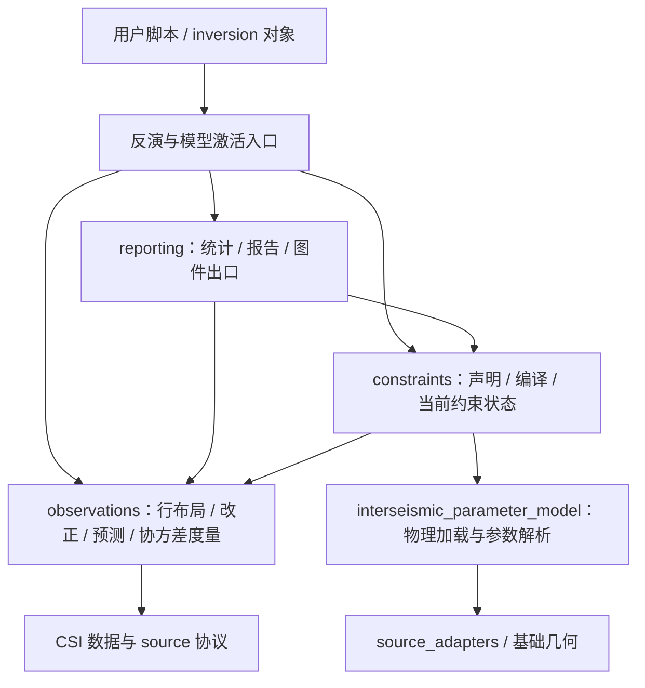

# 观测与约束支撑源码

新增文件的统一归属规则仍以[架构页](architecture.md#新增文件归属规则)为准。
本页维护观测、约束和改正结果模块的导航与导入迁移；完整科学定义继续由各 reference 页负责。

## 层级与状态拥有者



箭头表示调用或消费关系。CSI 继续拥有观测对象、坐标、source、mesh 和 GF；
`observations` 只组织跨反演共用的观测合同，不把 readers、预处理、时间序列或整个正演体系搬入。
`compute` 继续负责计算后端选择，不作为所有数值函数的总目录。

| 子包或模块 | 状态与责任 | 不应接管 |
| --- | --- | --- |
| `observations` | 行布局、一次性预测块、改正 H/系数解释、协方差度量 | 约束声明、代表模型激活、求解或 mesh 发布 |
| `constraints` | 声明、resolved bounds/rows、事务和 revision、目标参数空间编译 | 物理加载定义、数据筛选、GF 或反演算法 |
| `reporting` | 已有结果的解释、表格/文件、图件编排 | 重定义观测顺序、改正参数或约束状态 |
| `interseismic_parameter_model` | Euler 物理投影、loading 线性项、column/单位解析 | 反向导入约束编译器 |
| `source_adapters` | 多源接口和通用 source 查找 | 震间配置、观测行布局或绘图状态 |

报告中确需重建诊断预测的显式入口继续委托预测拥有者；本次归组不取消其原有行为。
约束可消费 `config.config_utils` 的单位合同，观测系数解释也可消费这个轻量模块；
不因此引入完整 Config 或 inversion 的反向依赖。

## 按任务阅读

| 任务 | 顺序 |
| --- | --- |
| GPS/标量观测与 synthetic 错配 | `observations/data_vector_layout.py` → `data_prediction.py` → [排列合同](../concepts/observation_matrix_layout.md) |
| 非线性 nuisance correction | Config → `observations/data_corrections.py` → nonlinear predictor；[改正参考](../reference/data_corrections.md) |
| 线性改正参数解释 | `observations/data_correction_parameters.py` → `reporting/data_correction_report_mixin.py` → `data_correction_results.py` |
| 命名改正参数相等或 bounds | `constraints/data_correction_constraints.py` → 对应 manager → [约束参考](../reference/constraint_manager.md) |
| 协方差加权、似然与 VCE | `observations/covariance_utils.py` → 实际 BLSE/VCE/SMC 消费者；[BLSE/VCE](../reference/blse_vce.md) |
| 约束覆盖或缓存 | inversion 公开方法 → `constraints/constraint_manager_blse.py` / `constraint_manager_smc.py` → `constraint_manager_base.py` |
| Euler 物理加载与 cap | `interseismic_parameter_model.py` → `constraints/euler_inequality_constraints.py`；block sharing 另见 `constraints/block_euler_constraints.py` |

目录内 `README.md` 是短文件索引；本页是完整导航与迁移入口，不在 README 复制参数字典。

## 必须保持的科学差异

- GPS 的行顺序是 E(all)、N(all)、可选 U(all)；`d/pred/G/H/Cd` 必须同序。
- 正式线性预测是已经组装的 `G @ mpost`；选择 source、分量或改正贡献属于诊断正演。
  发布 synthetic 是显式动作，不因为目录变化自动发生。
- 确定性观测参考改正与参与反演的 nuisance 参数是两个合同。
- 协方差估计和精确白化是两个层次；单位/对角 fast path 不删除非零相关项。
- BLSE/VCE 用完整线性向量；Bayesian sampled space、fixed-rake 布局与 SMC_FJ linear suffix
  不能机械视为同一空间。Bayesian 线性矩阵约束只在 `SMC_FJ + ss_ds` 生效；FULLSMC
  保持 bounds/prior 合同，不能因目录归组增加线性矩阵支持。
- Euler cap 的 `motion_sense`、`loading_sign`、hard-overlap policy 保持独立；block equality
  也不合入 cap 公式。两个 Euler pole 转换入口的单位不同：物理加载 helper 使用 radians，
  用户改正解释入口使用自身公开的角度/角速度参数，不能以同名概念替换。
- 通用 source lookup 和 `interseismic_fields` 的 fault lookup 保留不同的失败诊断；
  本次不合并错误信息或 field helper 的语义。

## 导入迁移 {#observation-constraint-import-migration}

主 inversion 类、fault/CSI 对象方法和既有 `eqtools.csiExtend` 包级公开导出保持不变。
下面的十二个根层实现模块移除旧路径，不新增转包壳。新脚本直接导入所属子包。

| 原 `eqtools.csiExtend` 下的模块 | 当前相对模块 |
| --- | --- |
| `data_vector_layout` | `observations.data_vector_layout` |
| `data_prediction` | `observations.data_prediction` |
| `data_corrections` | `observations.data_corrections` |
| `data_correction_parameters` | `observations.data_correction_parameters` |
| `covariance_utils` | `observations.covariance_utils` |
| `constraint_manager_base` | `constraints.constraint_manager_base` |
| `constraint_manager_blse` | `constraints.constraint_manager_blse` |
| `constraint_manager_smc` | `constraints.constraint_manager_smc` |
| `data_correction_constraints` | `constraints.data_correction_constraints` |
| `euler_inequality_constraints` | `constraints.euler_inequality_constraints`，物理 helper 见下表 |
| `data_correction_report_mixin` | `reporting.data_correction_report_mixin` |
| `data_correction_results` | `reporting.data_correction_results` |

| 函数 | 当前拥有者 |
| --- | --- |
| `calculate_euler_matrix_for_points`、`calculate_reference_strike_vector`、`convert_euler_pole_to_vector`、`project_euler_to_strike` | `eqtools.csiExtend.interseismic_parameter_model` |
| `generate_block_euler_equality_constraints` | `eqtools.csiExtend.constraints.block_euler_constraints` |
| 通用 `get_faults_from_inversion`、`get_fault_by_name` | `eqtools.csiExtend.source_adapters`；原 field helper 保留在 `interseismic_fields` |

```python
from eqtools.csiExtend import DataCorrectionParameterRef
from eqtools.csiExtend.observations.covariance_utils import prepare_covariance_metric
from eqtools.csiExtend.constraints.constraint_manager_blse import ConstraintManagerBLSE
```

模块路径是有意的升级边界；签名、默认值、公式、单位、索引和数值输出保持原合同。
旧 pickle 若记录了已删除模块里的 dataclass/manager 路径，不能保证直接恢复。
先在可信且能读旧对象的旧环境导出数据、配置和必要字段，再由当前类重建并另存。
修改脚本 import 不能自动修复 pickle；不添加隐式 `sys.modules` alias 或通用 unpickler。
纯数据文件不因 Python 模块归组自动变更，但仍应按其具体格式检查。

原八个 reporting 根层兼容壳也已移除，路径和旧 `SMCPlotData` 存档边界见[结果模块迁移](architecture.md#reporting-import-migration)。
排查顺序见[升级与依赖迁移](../getting_started/upgrading.md)。
